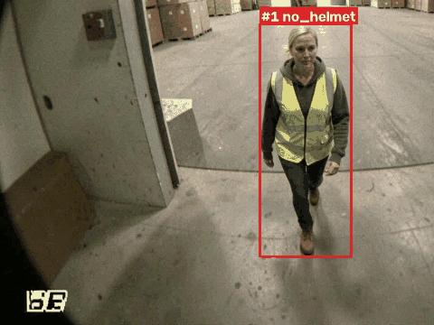
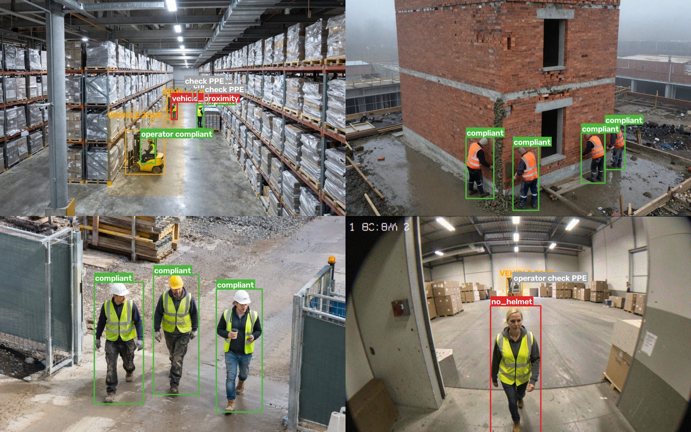

# MineSafe Vision: Real-Time PPE & Vehicle-Proximity Monitoring

[](https://github.com/harshit-3/minesafe-vision/actions)

A computer-vision safety system for mine sites, construction sites and warehouses. It checks every
worker in a camera frame for **missing helmets and hi-vis vests**, flags **pedestrians inside a
forklift or vehicle's exclusion zone**, and turns frame-by-frame detections into **debounced
per-worker safety events** that a supervisor can act on.

Fine-tuned **YOLO26s** runs at **119 FPS with TensorRT FP16** on a laptop RTX 4070, and the deployable
API needs **no PyTorch**: just ONNX Runtime + OpenCV.




*Held-out test images. Green = compliant, red = violation, grey = PPE not visible. The amber box is
the vehicle exclusion zone. The forklift driver is recognised as the operator and exempt from the
proximity rule.*

## Results

### Detection (200 held-out test images, never used for training or model selection)

| Model | Input | mAP50 | mAP50-95 | Precision | Recall |
|---|---|---|---|---|---|
| YOLO26n (baseline) | 640 | 0.745 | 0.527 | 0.862 | 0.685 |
| **YOLO26s (deployed)** | **960** | **0.845** | **0.629** | **0.900** | **0.788** |

Per-class mAP50 (deployed model): person 0.98 · vest 0.95 · goggles 0.96 · helmet 0.92 · gloves 0.89 ·
boots 0.87 · forklift 0.85 · **no_helmet 0.80** · **no_vest 0.79** · no_boots 0.81 · no_gloves 0.76 · no_goggle 0.55.

The larger model at higher resolution adds 10 mAP50 points, mostly on small "absence" classes
(no_goggle 0.22 → 0.55, no_helmet 0.66 → 0.80). Small PPE items need pixels.

### Worker-level violation detection: the metric a safety team cares about

mAP measures box quality. What matters on site is **whether the right workers get flagged**. The same
rules engine runs on ground-truth boxes and on predictions, workers are matched by IoU, and each
violation is scored as a true or false accusation:

| Policy | No helmet: precision / recall | No vest: precision / recall |
|---|---|---|
| **Lenient** (PPE not visible → don't accuse), conf 0.25 | **0.94** / 0.74 | **0.94** / 0.69 |
| **Strict** (PPE not visible → flag for review), conf 0.25 | 0.72 / **0.89** | 0.74 / **0.85** |

96% of ground-truth workers are found. The policy is a site decision, so it's a config flag
(`SiteConfig.unknown_is_violation`): use *lenient* for alerts that go straight to supervisors (few
false accusations) and *strict* for a review queue (catches more).

### Deployment speed (RTX 4070 Laptop / i9-14900HX, 1280×960 frame, includes pre/post-processing)

| Runtime | mAP50 | mAP50-95 | Latency p50 | FPS |
|---|---|---|---|---|
| PyTorch FP32 (GPU) | 0.846 | 0.629 | 16.6 ms | 60 |
| PyTorch FP16 (GPU) | 0.845 | 0.626 | 18.5 ms | 54 |
| ONNX Runtime (CUDA) | 0.840 | 0.614 | 27.6 ms | 36 |
| ONNX Runtime (CPU) | 0.840 | 0.614 | 92.0 ms | 11 |
| **TensorRT FP16** | **0.840** | **0.624** | **8.4 ms** | **119** |

TensorRT FP16 gives a **2× speed-up over PyTorch for −0.6 mAP50**, enough for about 4 camera streams at
30 FPS on one laptop GPU. Every format was re-validated on the test set, so the speed-ups are measured
against accuracy, not assumed.

## How it works

```
camera frame ─▶ YOLO26s (ONNX/TensorRT, NMS-free) ─▶ IoU tracker ─▶ rules engine ─▶ debouncer ─▶ events.jsonl
                 12 classes: person, helmet,          worker IDs      per-worker       violation must      + annotated
                 vest, no_helmet, forklift, ...      across frames   PPE + zones      persist ~0.4 s      video / API
```

**Rules engine** ([`src/minesafe/rules.py`](src/minesafe/rules.py), 14 unit tests):
- **PPE is assigned to a specific worker.** A helmet counts only if its centre is in the top 35% of
  that person's box, so a helmet lying on the ground doesn't make the worker compliant. In crowds,
  items go to the tightest enclosing person box.
- **Three-state PPE status** (`ok` / `missing` / `unknown`). An occluded or tiny worker isn't accused,
  and isn't marked compliant either.
- **Vehicle exclusion zones** move with each detected forklift (box + configurable margin). Proximity is
  tested at the worker's **feet** (bottom-centre), which is where they actually are on the ground plane.
- **Operator exemption.** A person whose box sits mostly inside a vehicle's box is its driver, not a
  pedestrian at risk.
- **Static restricted zones** (polygons per camera, e.g. conveyor, blast area) are also tested at the feet.
- **Debouncing.** An event fires only when the same tracked worker shows the same violation for
  ≥ 0.4 s within a 0.6 s window, then stays quiet for 30 s. In the demo, a worker visible for 90 frames produces
  **one** `no_helmet` event, not 90 alerts.

**Engineering choices:**
- YOLO26 exports **end-to-end (NMS-free)**: the ONNX graph outputs final `[300, 6]` boxes. The serving
  detector ([`detector.py`](src/minesafe/detector.py)) is under 70 lines of numpy + OpenCV + ONNX Runtime,
  with no torch or ultralytics in the Docker image.
- **Leakage-free splits.** The official 200-image validation set is the untouched *test* set. Model
  selection uses a seeded 15% split of the training data.
- **Data loading was the bottleneck, not the GPU** (GPU at 27% utilisation). Downscaling the 2048 px
  source images once to 1280 px (labels are normalised, so they stay valid), caching them in RAM and
  adding loader workers fixed it.

## Quick start

```bash
pip install -r requirements.txt                         # inference only (no torch)
PYTHONPATH=src uvicorn minesafe.api:app --port 8000     # API, docs at /docs
curl -X POST localhost:8000/detect -F "file=@assets/examples/forklift_2.jpg"
curl -X POST "localhost:8000/detect/annotated?required_ppe=helmet,vest,goggles" -F "file=@site.jpg" -o out.jpg
PYTHONPATH=src python -m minesafe.pipeline site_video.mp4 --out annotated.mp4 --events events.jsonl
```

```json
{"workers": 3, "compliant": 0, "violations": 1,
 "details": [{"box": [537.3, 332.9, 723.3, 819.0], "ppe": {"helmet": "missing", "vest": "ok"},
              "violations": ["no_helmet"], "operator": false}, ...],
 "detections": [...], "latency_ms": ...}
```

**Demo app:** `pip install gradio pandas && python app.py`. Image and video tabs, with adjustable
PPE requirements, exclusion margin and confidence.

**Docker:** `docker build -t minesafe . && docker run -p 8000:8000 minesafe`

**Reproduce training** (about 40 min on an RTX 4070 Laptop):

```bash
pip install -r requirements-train.txt
curl -L -o ppe.zip https://github.com/ultralytics/assets/releases/download/v0.0.0/construction-ppe.zip
mkdir -p datasets && unzip -q ppe.zip -d datasets
python scripts/resize_dataset.py && python scripts/make_splits.py
python scripts/train.py --model yolo26s.pt --imgsz 960 --epochs 80 --name s960
python scripts/export_benchmark.py --run s960          # ONNX + TensorRT + speed/accuracy table
python scripts/eval_violations.py                      # worker-level precision/recall
```

## Limitations & next steps

- **Domain gap.** The dataset mixes real photographs and generated images of construction sites and
  warehouses. Underground or open-pit mine footage (dust, low light, haul trucks rather than forklifts)
  would need a few hundred site-specific labelled frames for fine-tuning. The rules engine and
  pipeline carry over unchanged.
- **Vehicles.** Only forklifts are labelled. Adding haul trucks, loaders and light vehicles is a
  data task, not an architecture change (`VEHICLES` in `rules.py`).
- **Tracking.** A simple IoU tracker is enough for debouncing at fixed cameras. Crowded scenes would
  benefit from ByteTrack / BoT-SORT with re-ID.
- **2D proximity.** Distance is measured in image space. A per-camera ground-plane homography would
  give metric distances ("within 5 m of a moving vehicle").
- **Video evaluation.** The demo GIF is a simulated camera pan over a test image, since real
  labelled site video wasn't available. Event-level precision on real footage is the next metric to
  measure.

## Project layout

```
src/minesafe/
  detector.py   ONNX Runtime detector (letterbox, end-to-end decode, CUDA/CPU)
  rules.py      PPE assignment, vehicle/restricted zones, operator exemption, debouncer
  tracker.py    IoU tracker for worker identities
  pipeline.py   image/video pipelines, annotation, event log
  api.py        FastAPI service
app.py          Gradio demo (Hugging Face Spaces ready)
scripts/        dataset prep, training, export + benchmark, worker-level evaluation, demo assets
reports/        test metrics, benchmark and violation-evaluation JSON
```

## Data & license

**Ultralytics Construction-PPE Dataset**, Ultralytics team, November 2026, CC BY 4.0. 1,000 images,
12 classes. Example images in `assets/` come from its validation split.

Model training uses [Ultralytics](https://github.com/ultralytics/ultralytics) (AGPL-3.0), so this
repository and the trained weights are released under **AGPL-3.0**.
